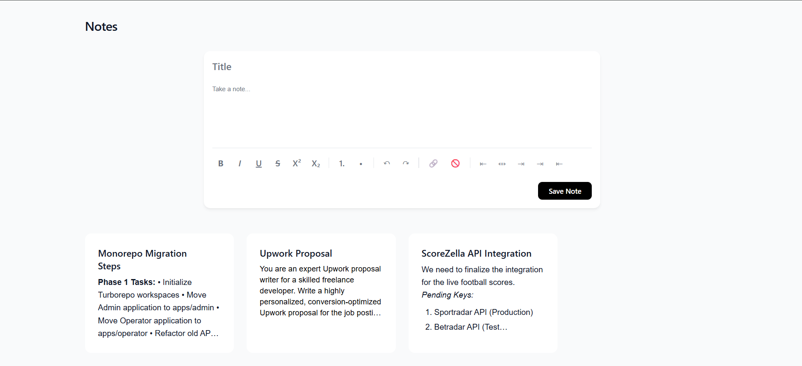

# Chrome Rich Notes - Modern Offline Notes

A sleek, offline-first Chrome extension for managing rich-text notes. Instead of a constrained popup, Chrome Rich Notes opens in a dedicated full-screen tab, offering a premium, distraction-free note-taking environment with a minimal, "cardless" aesthetic.



## ✨ Features

- **Offline-First Architecture:** All data is synced instantly to Chrome's local storage. No external databases, no latency, and fully functional without an internet connection.
- **Smart Input:** Features an auto-expanding, single-line input bar that smoothly transitions into a full rich-text editor on focus.
- **Rich Text Formatting:** Built-in editing tools (Bold, Italic, Underline, Lists, Links, Text Alignment, and Indentation) using native browser commands.
- **Drag & Drop Sorting:** Reorder your note cards fluidly using the HTML5 Drag and Drop API.
- **Real-Time Modal Editing:** Click any note to expand it in a focused overlay. Edits sync instantly to the grid behind it without requiring page reloads.
- **Zero Dependencies:** Built entirely with vanilla HTML, CSS, and JavaScript. No build steps, no heavy frameworks—just lightning-fast execution.

## 🚀 Installation (Developer Mode)

To use or test this extension locally in Chrome:

1. Download or clone this repository to your local machine.
2. Open Google Chrome and navigate to `chrome://extensions/`.
3. Enable **Developer mode** using the toggle switch in the top right corner.
4. Click the **Load unpacked** button in the top left.
5. Select the folder containing the extension files.
6. Pin the extension to your toolbar, click the icon, and start taking notes!

## 📁 File Structure

```text
├── manifest.json   # Chrome extension configuration and permissions
├── background.js   # Service worker to route icon clicks to a new tab
├── index.html      # Main application markup
├── styles.css      # Minimalist styling and responsive grid
├── app.js          # Core logic (Storage, Drag & Drop, Rich Text, Modals)
├── icon.svg        # Scalable vector icon
└── assets/
    └── screenshot.png # Repository preview image
```
